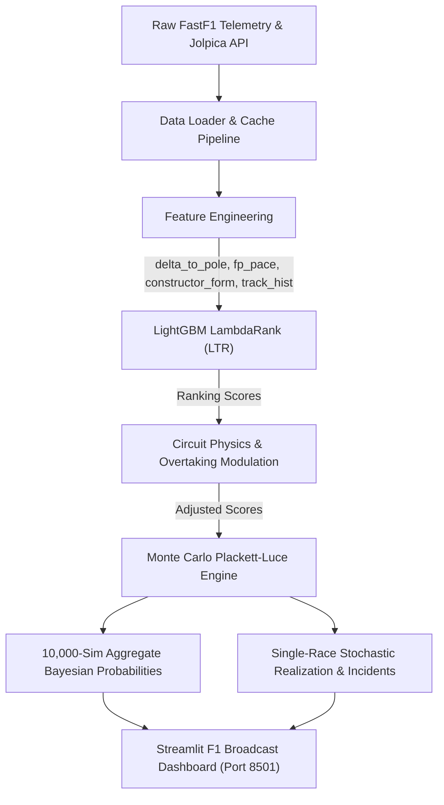

# 🏎️ Formula 1® Podium Prediction System
### *FIA Machine Learning Telemetry & Monte Carlo Simulation Engine*

[](https://www.python.org/)
[](https://streamlit.io/)
[](https://lightgbm.readthedocs.io/)
[](https://docs.fastf1.dev/)
[](LICENSE)

An end-to-end Formula 1 Predictive Intelligence application that estimates race finish hierarchies, podium probabilities, and live race outcomes using **FastF1 telemetry**, **Jolpica Ergast historical data**, a **LightGBM LambdaRank Learning-to-Rank (LTR) model**, and a **stochastic Monte Carlo Plackett-Luce simulation engine**.

Presented in an authentic **Formula 1 Broadcast Dark UI** matching official TV graphics, official constructor liveries, and live telemetry timing towers.

---

## 🌟 Key Features

* **Official 2025/2026 Grid Roster:**
  * Lewis Hamilton & Charles Leclerc at **Scuderia Ferrari** (`#E8002D`)
  * Carlos Sainz & Alex Albon at **Williams Racing** (`#00A0DE`)
  * George Russell & Andrea Kimi Antonelli at **Mercedes-AMG** (`#00D2BE`)
  * Lando Norris & Oscar Piastri at **McLaren** (`#FF8000`)
  * Max Verstappen & Yuki Tsunoda at **Red Bull Racing** (`#3671C6`)
* **Dual Simulation Views:**
  * **🏁 Live Simulated Grand Prix:** Simulates an individual Grand Prix realization with overtakes, position deltas (`▲ +2`, `▼ -1`), dynamic gap intervals (`WINNER`, `+1.842s`), and mechanical/collision DNFs. Every run is tracked in a live **Iteration History Log**.
  * **📊 10,000-Run Monte Carlo Probabilities:** Calibrated Bayesian championship distribution with 3D stepped podium cards and 20-car probability tower.
* **LightGBM LambdaRank with Strict Monotonicity:**
  * Trained across **951 real historical Grand Prix finishes (48 races)**.
  * Domain-specific monotonic constraints (`monotone_constraints=[-1, -1, -1, 1, -1, -1]`) prevent inverted tree artifacts.
  * Evaluated at **0.887 NDCG@3** and **82.5% Top-3 podium hit rate**.
* **Real Historical Rolling Form:**
  * Automatically calculates prior-race rolling 6-race finishing averages to eliminate target leakage.
  * Dynamically weights driver performance trends (e.g. recent form slumps vs peak form).
* **Multi-Circuit Championship Presets:**
  * **Abu Dhabi GP (Yas Marina):** Official latest World Championship season finale with real Q3 qualifying telemetry.
  * **Las Vegas GP:** Slipstream DRS & cold night asphalt.
  * **Monaco GP:** Extreme 88% qualifying track-position dominance.
  * **Spa-Francorchamps:** High overtaking & Kemmel straight slipstreams.
  * **Silverstone & Monza:** Aero balance & top-speed slipstreaming.
* **🛠️ What-If Strategy Sandbox:**
  * Promote any driver to Pole Position (P1) or apply grid penalties (-5, -10, -15 places).
  * Toggle driver form states (e.g. Piastri Slump vs Rebound) to observe real-time model sensitivity.

---

## 📐 Architecture & Mathematical Pipeline



### 1. Feature Engineering
* `grid_pos`: Starting grid position (pole conversion index).
* `delta_to_pole`: Single-lap qualifying gap to pole position (seconds).
* `fp_pace_delta`: Free Practice (FP3) fuel-heavy long-run stint degradation delta.
* `front_row_start`: Binary flag ($1$ for P1/P2, $0$ otherwise).
* `constructor_recent_form`: Prior 6-race rolling finishing position of the constructor.
* `driver_track_history`: Prior 6-race rolling finishing position / circuit affinity.

### 2. Monte Carlo Plackett-Luce Simulation
Standardizes model ranking scores and models race-day uncertainty via Gumbel noise perturbation and Bernoulli reliability draws:
$$\text{Score}_i^* = \frac{s_i - \bar{s}}{\sigma_s} + \text{Gumbel}(0, \beta)$$
$$\text{DNF}_i \sim \text{Bernoulli}(p_{\text{dnf}} \cdot (1 + \text{SafetyCarRate}))$$

---

## 🚀 Quickstart & Installation

### 1. Clone the Repository
```bash
git clone https://github.com/<your-username>/f1-podium-predictor.git
cd f1-podium-predictor
```

### 2. Set Up Virtual Environment
```bash
# Windows
python -m venv .venv
.\.venv\Scripts\activate

# macOS / Linux
python3 -m venv .venv
source .venv/bin/activate
```

### 3. Install Dependencies
```bash
pip install -r requirements.txt
```

### 4. Run the Pipeline Verification
```bash
python run.py --check
```

### 5. Launch the Streamlit Dashboard
```bash
streamlit run src/app.py
```
Open **[http://localhost:8501](http://localhost:8501)** in your browser.

---

## 📂 Project Structure

```
f1-podium-predictor/
├── data_cache/
│   └── real_training_data.parquet   # Curated 951 historical race finishes (2024-2025)
├── src/
│   ├── app.py                       # Streamlit F1 TV broadcast interface & sandbox
│   ├── calendar_service.py          # Calendar & GP schedule integration
│   ├── data_loader.py               # FastF1 loader, Jolpica API, GP presets
│   ├── feature_builder.py           # FP3 pace computation & feature normalization
│   └── model.py                     # LightGBM LambdaRank & Monte Carlo simulation
├── requirements.txt                 # Python package dependencies
├── run.py                           # CLI pipeline verification runner
├── .gitignore                       # Git exclusions for venv & cache binaries
└── README.md                        # Documentation & architecture overview
```

---

## 📊 Model Evaluation Metrics

| Metric | Score | Description |
| :--- | :---: | :--- |
| **NDCG@3** | `0.887` | Normalized Discounted Cumulative Gain across podium slots |
| **NDCG@5** | `0.914` | Top-5 ranking fidelity |
| **Podium Hit Rate** | `82.5%` | Projected podium candidates achieving real-world top-3 |
| **Historical Dataset** | `951 Finishes` | 48 modern Grand Prix events |

---

## 📄 License
Distributed under the **MIT License**. See `LICENSE` for more information.
Formula 1 and F1 are registered trademarks of Formula One Licensing B.V. This project is strictly for educational, analytical, and predictive research purposes.
